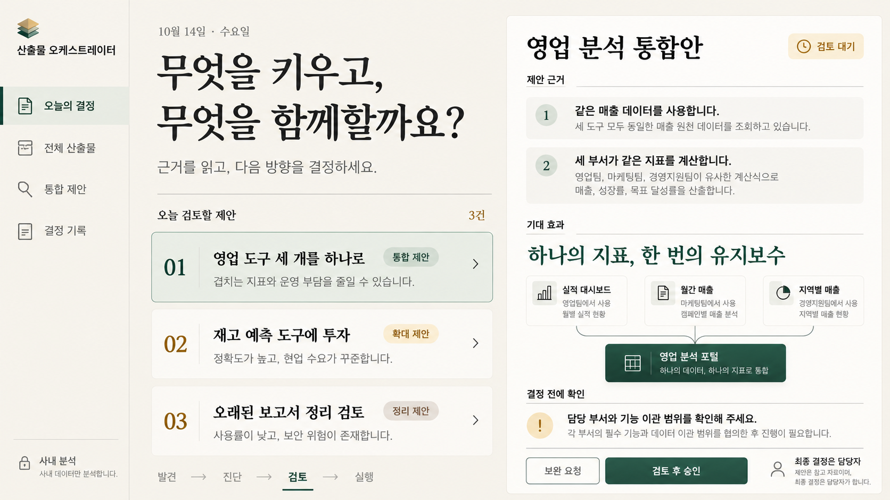
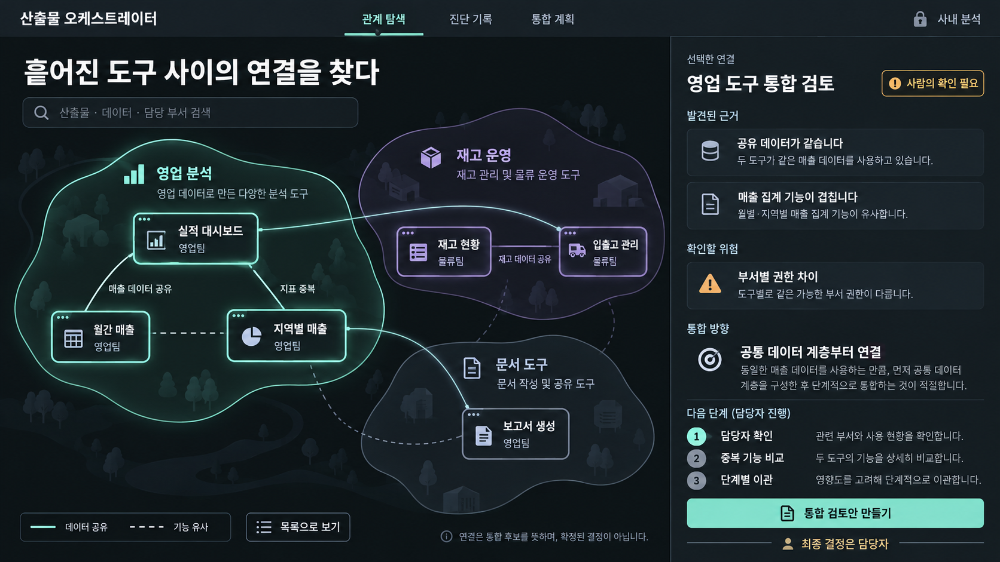
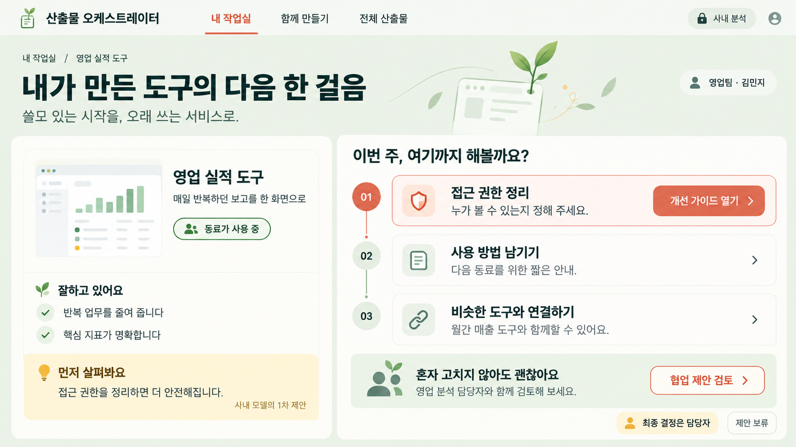

# 산출물 오케스트레이터: 세 가지 디자인 방향

2026-10-14에 수정된 [요청서](../concept-image-request.md)와 [이슈 #1](https://github.com/ms19942002-spec/-1/issues/1)을 기준으로 만든 탐색용 시안입니다. 기존의 화면 4장, 색상, 차트, 예시 숫자 지정은 적용하지 않았습니다.

서로 다른 사용자에게 가장 중요한 순간을 한 화면씩 제안합니다. 시안의 산출물·부서·이름·진단 근거는 모두 설명을 위한 가상 예시이며, 실제 저장소 분석 결과가 아닙니다. 사내 설치형 모델의 1차 진단을 사람이 검토하고 최종 결정하는 제품을 전제로 합니다.

| 방향 | 중심 사용자와 질문 | 화면 구성 | 장점 | 보완할 점 |
| --- | --- | --- | --- | --- |
| A · 결정의 서재 | 경영진·팀장 / 오늘 무엇을 결정해야 하는가? | 검토 안건과 선택한 제안의 근거를 나란히 배치 | 판단에 필요한 맥락과 다음 행동이 명확함 | 대량 산출물 탐색과 원본 근거 조회 화면이 추가로 필요함 |
| B · 관계의 지도 | IT·DX / 무엇이 연결되어 있고 어디가 겹치는가? | 관계 탐색 지도와 근거·위험·통합 방향 패널 | 중복과 의존 관계를 발견하기 좋음 | 노드가 많아지면 검색·묶음·목록 대체 보기와 관계 출처 표시가 중요함 |
| C · 성장의 작업실 | 만든 직원 / 내 도구를 어떻게 더 좋게 만들까? | 산출물 소개, 개선 과제, 협업 제안 | 평가에 대한 부담을 낮추고 구체적인 개선 행동을 돕는 구성 | 전사 투자·정리 판단을 위한 별도 관리자 보기가 필요함 |

## A · 결정의 서재

아이보리 바탕, 짙은 녹색과 편집물 같은 타이포그래피를 사용했습니다. 지표를 나열하기보다 **검토할 안건 → 제안 근거 → 기대 효과 → 확인 사항 → 사람의 결정**으로 읽게 합니다. 제품을 조직의 의사결정 도구로 보여 주는 방향입니다.

핵심 장면은 세 영업 도구의 통합 제안을 검토하는 순간입니다. 승인 전 담당 부서와 기능 이관 범위를 확인하고 보완을 요청할 수 있습니다. 실제 구현에서는 승인과 실행을 분리하고, 최종 결정의 담당자·시각·근거를 기록하는 흐름을 권합니다.

- 이미지: [a-decision-library.png](a-decision-library.png)
- 실제 사용한 프롬프트: [a-decision-library.txt](prompts/a-decision-library.txt)

## B · 관계의 지도

어두운 탐색 공간 위에 민트와 보라색의 관계 묶음을 놓았습니다. 산출물의 개별 점수보다 **공유 데이터, 기능 중복, 부서 간 연결**을 출발점으로 삼습니다. 선택한 연결의 근거와 권한 차이를 우측에서 검토한 뒤 통합 검토안을 만드는 흐름입니다.

그래프의 선은 통합 확정이 아니라 조사할 단서입니다. 실제 구현에서는 관측된 데이터 공유와 추정된 기능 유사성을 구분하고, 모든 선에서 출처와 신뢰도를 조회할 수 있어야 합니다. 시안의 장식 배경은 실제 화면에서는 줄이고, 확대·축소·필터·키보드 탐색·목록 보기를 제공합니다.

- 이미지: [b-relationship-map.png](b-relationship-map.png)
- 실제 사용한 프롬프트: [b-relationship-map.txt](prompts/b-relationship-map.txt)

## C · 성장의 작업실

연한 녹색, 따뜻한 흰색, 산호색 행동 버튼으로 만든 직원에게 친근하게 접근합니다. **잘하고 있는 점 → 먼저 살필 점 → 다음 과제 → 함께할 동료**로 이어집니다. 산출물을 점수로만 평가하기보다 오래 쓸 수 있는 서비스로 발전시키는 데 초점을 맞췄습니다.

접근 권한 정리, 사용 방법 작성, 유사 도구와의 협업을 실행 가능한 과제로 제안합니다. 직원은 제안을 검토하거나 보류할 수 있습니다. 실제 구현에서는 과제 담당자·완료 기준·진행 상태와 진단 근거를 함께 제공하는 것이 좋습니다.

- 이미지: [c-growth-studio.png](c-growth-studio.png)
- 실제 사용한 프롬프트: [c-growth-studio.txt](prompts/c-growth-studio.txt)

## 제안하는 시작점

첫 제품 방향으로는 **A를 기본 진입 화면으로 추천**합니다. 이 제품의 핵심인 ‘무엇을 키우고, 합치고, 정리할지 사람이 결정한다’는 가치를 가장 직접적으로 보여 줍니다. IT 담당자가 근거를 탐색할 때는 B, 만든 직원이 개선을 진행할 때는 C의 구성을 역할별 화면으로 확장할 수 있습니다. 함께 구현한다면 내비게이션·용어·상태·색상 체계를 통일해야 합니다.

## 제작 및 전달 정보

- 이미지 생성 도구로 제작한 초기 컨셉 PNG 3장입니다. 실행 가능한 UI나 확정된 디자인 시스템은 아닙니다.
- 각 이미지의 원본 크기는 1672 × 941 픽셀입니다. 변경된 요청서에는 최소 해상도 조건이 없습니다. 생성 원본을 그대로 보존했습니다.
- 모든 화면 문구는 한국어입니다. 생성에 사용한 프롬프트는 재현과 수정을 위해 도구에 전달한 영문 원문 그대로 보존했습니다.
- 세 이미지는 독립적으로 생성했습니다. 공통 제품 요구와 각 방향의 화면·문구·미술 지시가 각 프롬프트 파일에 모두 포함됩니다.
- 앱 코드·설정은 변경하지 않았습니다. 이미지에 실제 사내 코드·데이터·자격정보를 사용하지 않았습니다.
- 검토 시에는 시각적 취향과 함께 사용자 역할, 필요한 결정, 다음 행동을 기준으로 방향을 골라 주세요.
